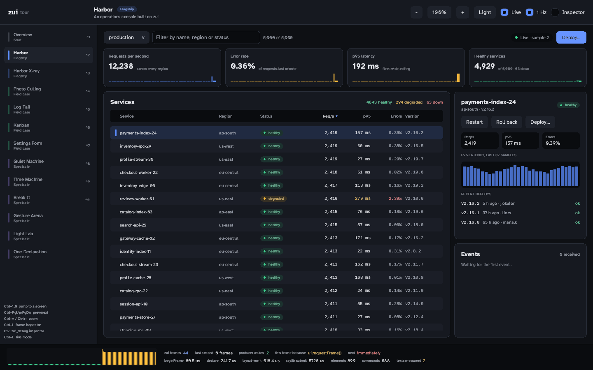

# The tour

`zui_tour` shows what zui does today, four ways, for any host, renderer
and font system: a product built on it, the same product with each
feature pointed out, real problems solved plainly, and pages built to
impress:

```zig
const Tour = zui_tour.App(.{ .Host = zui_raylib.Host, .Renderer = zui_raylib.Renderer, .Text = zui_truetype.Text, .renderer_name = "raylib" });
```

is an application `zui_app.run` runs. It sets its text in the three
`zui_fonts` typefaces, laid out for the placement the renderer draws, and
offers a screen only when the renderer draws what it needs. It imports no
renderer, host or font system, and compiles for `wasm32-freestanding`.
Each renderer's or host's `tour` target names it with its own host,
renderer and font system:

| Target | Run from |
|---|---|
| raylib's window and renderer | [renderers/raylib/](../../renderers/raylib/README.md#the-tour) |
| a native window, drawn by the sokol renderer | [hosts/native/](../../hosts/native/README.md#the-tour-on-a-native-host) |
| the terminal | [renderers/terminal/](../../renderers/terminal/README.md) |
| a browser, in a Web Worker | [hosts/web/](../../hosts/web/README.md) |

A strip along the bottom times every zui frame: how many frames were
declared, and in the last second; why each frame was declared (input, a
resize, `requestFrame`, a `requestFrameAt` deadline, a source); what
`nextFrame` asked for; the cost of `beginFrame`, declaration, layout and
emission, and the renderer's drawing; element and command counts; and
how many texts missed the measurement cache. **Ctrl+I** opens a draggable
frame inspector with the last 120 frames, the frame's limits and
diagnostics, and the environment. **F12** opens zui's own inspector,
`zui_debug`, along the right edge: the frame's diagnostics, the fallbacks
in effect (what the renderer lowers and the host lacks), each zone's time
from its `ZoneTimer` tracer, the element tree, and the configs of the
element under the pointer. `zui_app`'s `zuiObserve` hands it each frame.
The tour sets the record's zoom and the environment changes it makes up,
hands each frame to `zui_debug` while its panel is open, and times each
step for the strip.

Each screen belongs to a lane, which the rail marks beside its title.

| Screen | Lane | What it shows |
|---|---|---|
| Overview | Start | zui in one sentence, how a frame goes (declare, lay out, draw, sleep), and every screen this renderer is offered, by lane, opened by click or key; it asks for no frame, so the tour idles here |
| Harbor | Flagship | an operations console for 5,000 services: KPI tiles from a `Latest` source with sparklines, a sortable table that declares only the rows in view, a details panel, an events feed from a `Stream`, a deploy dialog in a focus scope, tooltips anchored to their element, toasts that leave with an exit animation, panels with continuous corners (round on a renderer that draws only round ones), and semantics on rows, tiles and the dialog; its producers run only while it is read |
| Harbor X-ray | Flagship | the same console from the same state, with 14 numbered nodes attached to its real elements. Each opens a card saying what the feature is, why it matters, and live proof from this frame (rows declared, values published and skipped, `framesSinceRead`, texts measured, why the frame was declared, what the renderer lowered, which corner shapes it drew round), with buttons that try it: a burst of events, right to left, 200% text, high contrast. It also outlines regions and shows a timeline of why each frame was declared |
| Photo Culling | Field case | 5,000 photos in a virtual grid, each decoded through `KeyedLoads` on other threads with progress and cancelled when scrolled away; pick, reject and undo by key, drag onto bins, a loupe, and the decoder's counts |
| Log Tail | Field case | a busy service's log through a `Stream`, with its rate through a `Latest` 30 times a second: a 4,096-line ring in a virtual list, level chips, a filter, follow-tail that holds when scrolled up, and a 10,000-line burst that shows what the stream refused |
| Kanban | Field case | four lists of cards dragged within and between lists with a drop indicator and auto-scroll, moved by Ctrl+arrows, deleted with an exit animation, and an actions menu in a focus scope |
| Settings Form | Field case | an account form with validation, a sensible Tab order and Save only when valid, and switches that change the real environment (right to left, high contrast, text at 150% and 200%) so it is seen to hold up |
| Quiet Machine | Spectacle | a busy page (a clock, a sensor, a countdown, a ticker) that declares a frame only when something changes, counted against a 60 Hz loop, with why each frame was declared and what `nextFrame` says; a toggle compares it with a game loop |
| Time Machine | Spectacle | a small deterministic world of flung balls, a pure function of its input log: a scrubber replays it to any step, interacting in the past branches, and a checksum proves the replay matches the live run |
| Break It | Spectacle | sliders that push elements, depth, text bytes, render commands, effects and state slots past their limits, with the frame's `Diagnostics`: what was kept and dropped, and nothing corrupted |
| Gesture Arena | Spectacle | a map that pans and pinch-zooms, holding a list that holds a carousel with momentum, and a lasso that claims presses; a log says which element took each gesture and why |
| Light Lab | Spectacle | gradients mixed in OKLab, shadows and glow, frost over a moving scene, the renderer's materials, and round, continuous and chamfered corners at the radius the controls set, each beside how a renderer without it lowers it, with its declaration printed as Zig. Frost needs `.backdrop_blur` and materials a `MaterialHandle` of patterns |
| One Declaration | Spectacle | one function's invoice in six views (dark, light, high contrast, 150% text, right to left, compact) sharing one state, and buttons that change the real environment |
| Clickable Chaos | Spectacle | offered only to a renderer that draws `.transform`: 240 cards turned and scaled in a wave, each hit where it is drawn |

Ctrl+1 to Ctrl+0 jump to the first ten screens, Ctrl+PgDn and Ctrl+PgUp
to the next and previous, Ctrl+= and Ctrl+- zoom (through
`FrameParams.zoom`), Ctrl+L declares a frame at every refresh to watch the
costs live, and Tab moves focus.



## Development

Run from `apps/tour/`; the first build fetches stb, since the tests
measure with `zui_truetype`:

| Command | What it does |
|---|---|
| `zig build test` | declare every screen headlessly on renderers that draw every optional command and none, in pixels and in cells, and check the tour's compile errors |
| `zig build check` | compile the tour and its tests, natively and for `wasm32-freestanding` |
