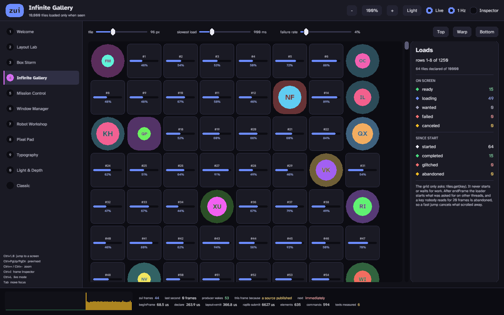

# The tour

`zui_tour` is a tour of what zui does today, one screen per feature, for
any host, renderer and font system:

```zig
const Tour = zui_tour.App(.{ .Host = zui_raylib.Host, .Renderer = zui_raylib.Renderer, .Text = zui_truetype.Text, .renderer_name = "raylib" });
```

is an application `zui_app.run` runs. It sets its text in the three
`zui_fonts` typefaces, laid out for the placement the renderer draws, and
offers a screen only when the renderer draws what it needs. It imports no
renderer, host or font system, and compiles for `wasm32-freestanding`.
Each renderer's or host's `tour` target names it with its own host,
renderer and font system:

| Target | Run from |
|---|---|
| raylib's window and renderer | [renderers/raylib/](../../renderers/raylib/README.md#the-tour) |
| a native window, drawn by the sokol renderer | [hosts/native/](../../hosts/native/README.md#the-tour-on-a-native-host) |
| the terminal | [renderers/terminal/](../../renderers/terminal/README.md) |
| a browser, in a Web Worker | [hosts/web/](../../hosts/web/README.md) |

A strip along the bottom times every zui frame: how many frames were
declared, and in the last second; why each frame was declared (input, a
resize, `requestFrame`, a `requestFrameAt` deadline, a source); what
`nextFrame` asked for; the cost of `beginFrame`, declaration, layout and
emission, and the renderer's drawing; element and command counts; and
how many texts missed the measurement cache. **Ctrl+I** opens a draggable
frame inspector with the last 120 frames, the frame's limits and
diagnostics, and the environment. **F12** opens zui's own inspector,
`zui_debug`, along the right edge: the frame's diagnostics, the fallbacks
in effect (what the renderer lowers and the host lacks), each zone's time
from its `ZoneTimer` tracer, the element tree, and the configs of the
element under the pointer. `zui_app`'s `zuiObserve` hands it each frame.
The tour sets the record's zoom and the environment changes it makes up,
hands each frame to `zui_debug` while its panel is open, and times each
step for the strip.

| Screen | What it shows |
|---|---|
| Welcome | `requestFrameAt` ticking a clock once a second with no frames between; floating hints; focusable cards |
| Layout Lab | every sizing rule, alignment and gap on a live container; the knobs generated by `zui_reflect`; sizes read back with `rectOf`; the same layout printed as Zig |
| Box Storm | up to 14,000 animated boxes, a 90-deep spiral of `percent` containers, and text walls that either hit the whole-string cache or miss it every frame |
| Infinite Gallery | 10,000 tiles in a virtualized scroll container, loaded through `KeyedLoads` on other threads with progress, failures and cancellation; a hand-made scrollbar |
| Mission Control | `Latest` telemetry, a `Stream` log that a burst overflows into the diagnostics, a `Task` rocket launch with abort; producers run only while `framesSinceRead` says someone is watching |
| Window Manager | draggable floating windows with z order, a taskbar with tooltips, `attach_to = .element` with every anchor pair, a modal dialog in a focus scope |
| Robot Workshop | a robot editor generated by `zui_reflect` from nested structs, and environment changes (theme, contrast, reduced motion, text scale) as if the OS sent them |
| Pixel Pad | painting through `pointerLocal` on one element, tools on keys, undo with chords, and a live view of `keyEvents` and `typedText` |
| Typography | three TrueType fonts, size, letter spacing, line height, wrap and alignment, a column to drag-resize, and a marquee looped with `measureText` and `setScrollOffset` |
| Light & Depth | `zui.Effects` on sliders with their declaration printed as Zig. A renderer that does not draw `gradient` or `shadow` sees them lowered: a gradient to its middle color, a shadow to nothing. Its frosted pane needs `.backdrop_blur` |
| Transforms | offered only to a renderer that draws `.transform`. `zui.Transform`: a card turned, moved and scaled about its origin from sliders, its declaration printed as Zig and its button pressed where it is drawn; turned tiles that hover and press where drawn; clock hands turned about their foot; the tour's three fonts, turned |
| Materials | offered only to a renderer that draws `.material`, such as `zui_sokol.Material`: a card drawn by the renderer's own shader, its pattern, colors, wave and phase on sliders and its declaration printed as Zig; every pattern side by side; the material beside its fallback background, as a renderer without `.material` draws it; a shadow beneath one and a border and button over it |
| Classic | `zui_showcase`, in [apps/showcase/](../showcase/), the UI every zui renderer's `showcase` target draws, so the renderers can be compared |

Ctrl+1 to Ctrl+0 jump to the first ten screens, Ctrl+PgDn and Ctrl+PgUp
to the next and previous, Ctrl+= and Ctrl+- zoom (through
`FrameParams.zoom`), Ctrl+L declares a frame at every refresh to watch the
costs live, and Tab moves focus.



## Development

Run from `apps/tour/`; the first build fetches stb, since the tests
measure with `zui_truetype`:

| Command | What it does |
|---|---|
| `zig build test` | declare every screen headlessly on renderers that draw every optional command and none, in pixels and in cells, and check the tour's compile errors |
| `zig build check` | compile the tour and its tests, natively and for `wasm32-freestanding` |
