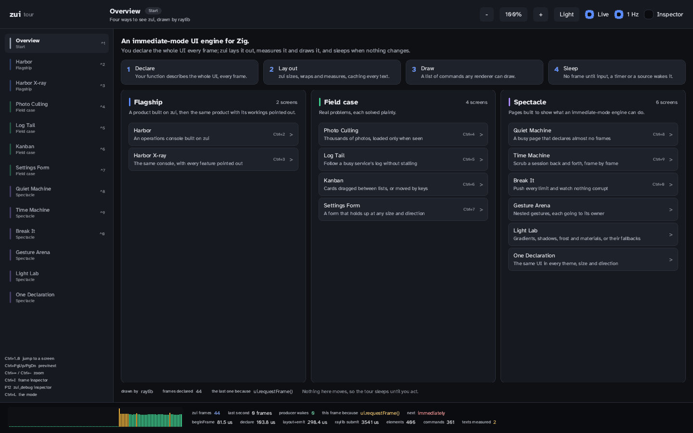

# The raylib renderer

`zui_raylib` is a [raylib](https://www.raylib.com) renderer (zui's
renderer contract, drawing any text's fonts) and an adapter host
(zui's host contract on raylib's window), so an application runs on it
through `zui_app` in one call. It needs raylib **6.0**, the newest raylib
release whose build supports Zig 0.16, which is fetched the first time it
is built; on Linux, raylib's X11 and OpenGL development packages:
`libx11-dev libxrandr-dev libxinerama-dev libxcursor-dev libxi-dev libgl1-mesa-dev`.



```zig
// build.zig, with `zui` the dependency from the main README
const zui_raylib = zui.builder.dependency("zui_raylib", .{ .target = target, .optimize = optimize });
exe.root_module.addImport("zui_raylib", zui_raylib.module("zui_raylib"));
```

Give `zui_raylib` the same `.@"zui-tracy"` you give `zui`, if any, so the
two build one `zui` module and their types match.

```zig
const zui = @import("zui");
const zui_app = @import("zui_app");
const zui_raylib = @import("zui_raylib");
const zui_truetype = @import("zui_truetype");

const App = struct {
    pub const Host = zui_raylib.Host;
    pub const Renderer = zui_raylib.Renderer;
    pub const Text = zui_truetype.Text;
    pub const Ui = zui.Context(zui_app.contextConfig(Renderer, .{ .Text = Text, .Sources = AppSources }));

    sources: AppSources = .{},

    pub fn zuiDeclare(app: *App, ui: *Ui) void {
        // ... declare your UI ...
    }

    pub fn zuiLoader(app: *App, ui: *const Ui, io: std.Io) void {
        // ... start what the frame asked for ...
    }
};

pub fn main(init: std.process.Init) !void {
    try zui_app.run(App, init, .{ .title = "My app", .size = .{ 1100, 700 } });
}
```

`zui_raylib.Renderer` implements zui's renderer contract. Its surface is
`.library`, raylib's own window: each `zuiSubmit` begins raylib's
drawing, clears to `clear_color`, draws the frame and presents it, or
with `drawOffscreen()` draws into a render texture that
`saveScreenshot(path)` saves, as the tour's `--screenshot` does; with
`.presentation = .draws_into_current_target` it only draws, into the
target its caller began, as its conformance harness does. raylib is
built with `SUPPORT_CUSTOM_FRAME_CONTROL`, so `EndDrawing` neither
presents nor polls input. It
draws each frame scaled by the record's zoom, and the host divides the
viewport and the pointer by it. `zui_app` hands its `init` the
application's `Text`, whose glyphs it rasterizes on first use into a
`zui_glyphs` atlas reserved there and uploaded as one texture, and draws
where `zui_glyphs` laid them out; text in a font id that text has no
face for is not drawn. `zui_app.contextConfig` builds the `Config` from its
declarations: `ImageHandle` is raylib's `Texture2D`, so `ui.image(.{ .handle = texture
}, ...)` draws directly, and there are no optional commands and no
`CustomData`. The renderer's `switch` over the commands therefore names
exactly the base commands and `image`. raylib's OpenGL context belongs to
the thread that opened the window, so it does not declare
`zui_render_thread`, and `zui_app` submits on the UI thread.

`zui_raylib.Host` implements zui's host contract with one window and no
system material. `zuiPoll` samples raylib's input and draws nothing;
`zuiWait` polls raylib's input once a turn, then sleeps in GLFW (compiled into raylib's default
desktop platform) until input arrives, the host is woken, or the instant
`nextFrame` names, and `.immediately` waits out the monitor's refresh
interval. Its `zuiWaker` sets a flag and posts an empty GLFW event, which
any thread may do; the flag is cleared only after a wait, so a wake
between `nextFrame` and the wait is not lost. Escape does not close the
window, since the application may want it. Beyond the contract:
- `script(sample)` replaces raylib's input for one poll, as the host
  suite and the tour's screenshots do;
- `close()` closes the window as its close button would.

| zui | raylib |
|---|---|
| `rectangle` | `DrawRectangleRec`, or `DrawRectangleRounded` with a corner radius |
| `border` | four bands inside the bounds; `DrawRectangleRoundedLinesEx` when uniform and rounded |
| `text` | a textured quad per glyph through rlgl, from the `zui_glyphs` atlas, where `zui_glyphs` laid it out |
| `image` | `DrawTexturePro` with the tint; with a corner radius, a fan of textured triangles through rlgl, each corner with its own radius |
| `clip_begin` / `clip_end` | `BeginScissorMode` / `EndScissorMode` with a stack, at the record's zoom |
| `gradient` / `shadow` | not drawn: zui lowers a gradient to its middle color and a shadow to nothing |
| zoom | rlgl's matrix scaled by `FrameParams.zoom`; the viewport and the pointer divided by it |
| pointer and keys | raylib's polled state, through `zui.InputSampler`; keys from `GetKeyPressed`, letters, digits and function keys included |
| wheel | `GetMouseWheelMoveV`, flipped and scaled by `InputOptions.wheel_step` |
| focus | `IsWindowFocused` changes, as the environment's `window_focused` |
| scale | `GetRenderWidth() / GetScreenWidth()`, as the record's scale |
| cursor request | `SetMouseCursor`, in `Host.zuiApply` |
| waits and wakes | GLFW's `glfwWaitEvents`, `glfwWaitEventsTimeout` and `glfwPostEmptyEvent` |

What raylib cannot do:
- **Sampled input.** raylib reports state once per frame, so a press and
  release between two frames is lost, as it is to raylib itself.
- **Corner radii.** raylib rounds all four corners of a rectangle or a
  border the same, so the largest of zui's four radii is used; an image
  rounds each corner by its own.
- **No IME window.** raylib cannot place one, so a text-input request is
  not applied.
- **One window.** `zui_capabilities.windows` is `.one`.

`zig build conformance` runs zui's two
suites in hidden windows: the renderer suite draws each frame into a
render texture and reads it back with `LoadImageFromTexture`, so it
checks every clip and fill, and the image's tint and rounded corners, by
their pixels; the host suite scripts the state `zui.InputSampler` reads
(`Host.script`), since raylib reports state, not events, and checks the
events' order, the waits and the wakes against the real window.

## Development

Run from `renderers/raylib/`; the first build fetches raylib and
compiles it:

| Command | What it does |
|---|---|
| `zig build test` | run the renderer's and host's unit tests |
| `zig build conformance` | run zui's renderer and host suites against them, in hidden windows; needs a display |
| `zig build check` | compile the renderer, its tests, the conformance suites and the targets without producing output |
| `zig build tour` | run the tour |
| `zig build tour -- --screen photo_cull` | start on one screen |
| `zig build tour -- --frames 900 --cycle 40` | visit every screen, 40 frames each, then quit; add `--hidden` to do it in a hidden window |
| `zig build tour -- --screenshot <absolute path> --screen harbor` | render offscreen in live mode, save a PNG, quit |
| `zig build tour -- --measure-idle` | report the CPU used over 10 idle seconds |
| `zig build tour -- --measure-startup` | report the time from process start to the first presented frame (Windows) |
| `zig build tour -- --zui-debug` | open `zui_debug`'s inspector, which F12 toggles |
| `zig build tour -Dzui-tracy=true` | trace zui's zones into Tracy 0.14.1 |
| `zig build showcase` | run the showcase; `-- --hidden --frames 60` draws 60 frames in a hidden window and quits |

Conformance and the targets open hidden windows, so they need a display;
CI runs them under `xvfb-run`.

## The tour

`zig build tour` runs [the tour](../../apps/tour/README.md) on raylib's
window and renderer. `examples/tour.zig` names it with raylib's host and
renderer, in `zui_truetype`'s text:

```zig
const Tour = zui_tour.App(.{ .Host = zui_raylib.Host, .Renderer = zui_raylib.Renderer, .Text = zui_truetype.Text, .renderer_name = "raylib" });
```

and adds what raylib's window gives: screenshots drawn offscreen, the
startup measurement, and the run's report in `zui_debug`'s panel. The
Light Lab's gradients, shadows, frost and materials are lowered here, and
Clickable Chaos, which needs transforms, is not offered. The `zui_debug` panel's
theme does not reload from a file, since this host has no file watch.
`examples/showcase.zig` runs `zui_showcase` the same way.

`--measure-idle` runs the tour in a hidden window and reads its own CPU
time at two frames it asks for with `requestFrameAt`, 10 seconds apart,
after 5 seconds of warm-up, with the strip's once-a-second refresh off.
The overview asks for no frame, so it declares 1, and on Linux it used
0.055% of one core over 10 s.
`--measure-startup` reports how long after the OS created the process the
first frame was presented (Windows only: it reads the process's creation
time).
